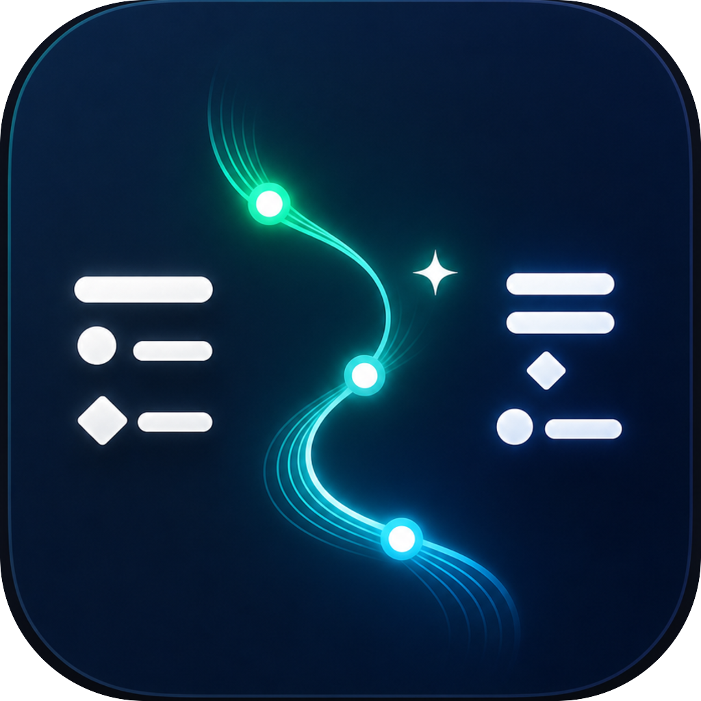
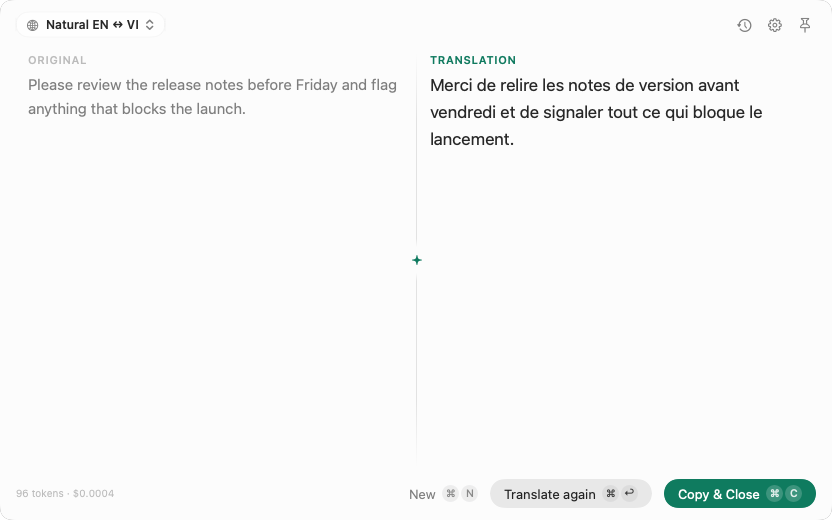
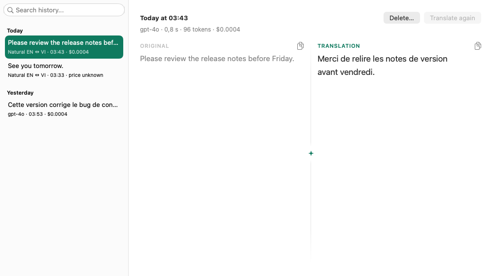

<div align="center">



# TransFlex

**Translate anything you select on your Mac, with the AI model you choose.**

A native macOS menu-bar translator. Press a shortcut in any app and the
translation streams in right there. Your API keys stay in your Keychain.

[](https://github.com/dratct/TransFlex/releases/latest)
[](https://github.com/dratct/TransFlex/actions/workflows/ci.yml)
[](#install)
[](LICENSE)

[**Download**](https://github.com/dratct/TransFlex/releases/latest) ·
[Website](https://transflex.aiaz.io/) ·
[Docs](docs/index.md) ·
[Report a bug](https://github.com/dratct/TransFlex/issues)

<picture>
  <source media="(prefers-color-scheme: dark)" srcset="docs/images/popup-dark.png">
  
</picture>

</div>

## Features

- **Popup translator.** One shortcut opens a floating panel: type or paste, press <kbd>⌘</kbd><kbd>⏎</kbd>, and the result streams in.
- **Translate Selection.** A shortcut per preset translates the text you have selected in any app and shows only the result.
- **Replace Selection.** Another shortcut translates the selection and pastes the result over it, without leaving the app you are writing in.
- **Image translation.** Drop or paste a screenshot and translate the text in it with a vision model.
- **Presets.** Save a prompt, provider and model together (say, "Natural EN ↔ VI" on one model and "Formal email" on another) and switch between them from the popup.
- **Your own provider.** OpenAI, Anthropic and Gemini are built in. Add any OpenAI-compatible endpoint, such as Ollama, LM Studio or vLLM running on your Mac.
- **History with cost.** Every translation is kept locally with its model, duration, tokens and price, and can be searched and exported.
- **Pin.** Keep the popup beside another app while you work, and drag it where you want it.

<div align="center">
<picture>
  <source media="(prefers-color-scheme: dark)" srcset="docs/images/history-dark.png">
  
</picture>
</div>

## Install

1. Download the latest `TransFlex-…-macos-universal-signed-notarized.zip` from [Releases](https://github.com/dratct/TransFlex/releases/latest).
2. Unzip it and move `TransFlex.app` to `/Applications`.
3. Open it. TransFlex lives in the menu bar and has no Dock icon.

TransFlex needs macOS 13 Ventura or later and runs on Apple Silicon and Intel.
Releases are signed with a Developer ID and notarized by Apple. The app
updates itself through [Sparkle](https://sparkle-project.org/).

## Getting started

1. On first launch, the welcome window asks for a provider and its API key. The key is saved in your Keychain.
2. Press <kbd>⌥</kbd><kbd>T</kbd> to open the popup. You can change the shortcut in Settings.
3. Type or paste text, pick a preset, and press <kbd>⌘</kbd><kbd>⏎</kbd>.

To translate what you have selected in another app, give a preset a
Translate Selection or Replace Selection shortcut in Settings. macOS asks for
the Accessibility permission the first time, because TransFlex has to copy
the selection and paste the result.

## Privacy

- API keys are stored in the macOS Keychain only.
- Text goes straight from your Mac to the provider you chose. There is no TransFlex server.
- No telemetry, analytics or usage pings.
- Traffic is HTTPS only, except plain HTTP to `localhost` for local models.

See [SECURITY.md](SECURITY.md) to report a vulnerability.

## Build from source

You need Xcode 15 or later and [XcodeGen](https://github.com/yonaskolb/XcodeGen).

```bash
brew install xcodegen
make test
make build
```

`make build` generates the Xcode project from `project.yml`, builds the Debug
app (`TransFlex Dev`, which opens with <kbd>⌥</kbd><kbd>Q</kbd> so it can run
beside the released app) and launches it. `make help` lists every target.

| I want to… | Read |
|---|---|
| Build and run it for the first time | [Getting started](docs/tutorials/getting-started.md) |
| Build, sign, test and debug day to day | [Development workflows](docs/how-to/development-workflows.md) |
| Understand how it is put together | [Architecture](docs/explanations/architecture.md) |
| Look up commands, storage paths and troubleshooting | [Commands and runtime](docs/reference/commands-and-runtime.md) |
| Cut a release | [Release](docs/how-to/release.md) |
| Work on the website in `site/` | [Website](docs/how-to/website.md) |

## Contributing

Bug reports and pull requests are welcome. Read [CONTRIBUTING.md](CONTRIBUTING.md) first, and run `make test` before you open a pull request.

## License

[MIT](LICENSE). Provider icons and trademarks are credited in [NOTICE.md](NOTICE.md).
